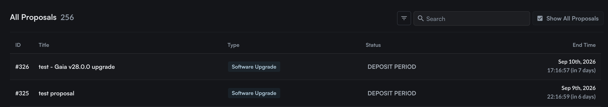
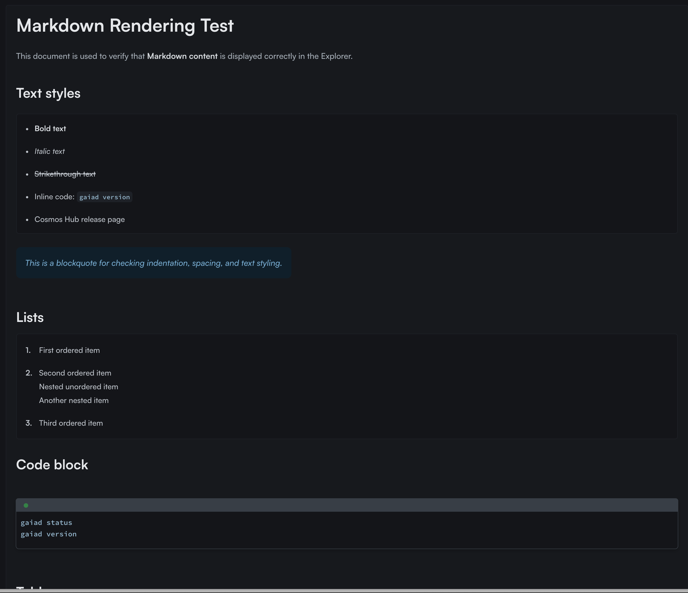
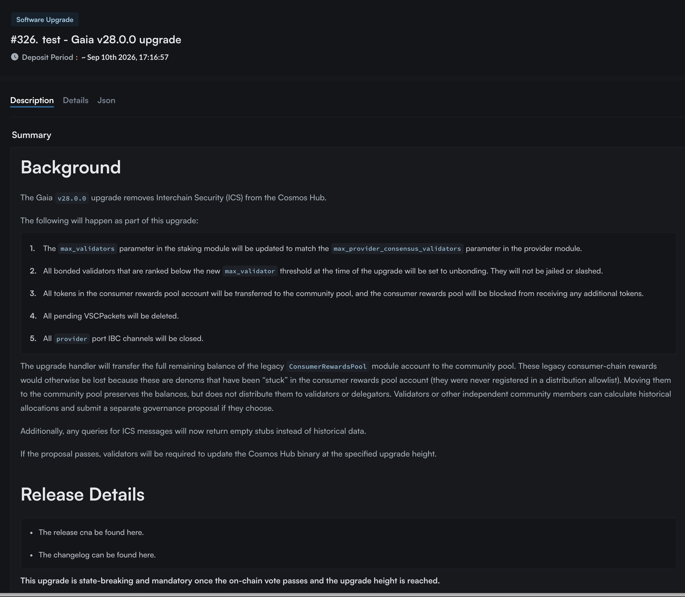

# gaia-proposal

A Go CLI for reproducibly generating Cosmos Hub software upgrade proposals from declarative files. It serializes Markdown summaries and Cosmovisor binary information into the JSON format accepted by `gaiad tx gov submit-proposal`.

## Build and Validate

```sh
make build
make generate example
make check
```

The executable is generated at `bin/gaia-proposal`.

## Upgrade Directories

Store each upgrade under `proposals/<version>`.

```text
proposals
├── example
│   ├── manifest.json  # title, deposit, metadata, authority, expedited
│   ├── plan.json      # name, height, binaries
│   ├── summary.md     # Source Markdown
│   └── proposal.json  # Generated file
└── v28.0.0
    ├── manifest.json
    ├── plan.json
    ├── proposal.json
    └── summary.md
```

Example `manifest.json`:

```json
{
  "title": "Gaia v28.0.0 Upgrade",
  "deposit": "500000000uatom",
  "metadata": "ipfs://CID",
  "expedited": false,
  "authority": "cosmos10d07y265gmmuvt4z0w9aw880jnsr700j6zn9kn"
}
```

Example `plan.json`:

```json
{
  "name": "v28.0.0",
  "height": "32785900",
  "info": {
    "binaries": {
      "darwin/amd64": "https://...",
      "linux/amd64": "https://..."
    }
  }
}
```

The `info` object is validated, compacted, and stored as an escaped JSON string in the proposal. Line breaks and quotation marks in `summary.md` are automatically escaped according to JSON rules.

## Generation Commands

Generate or validate a single directory:

```sh
bin/gaia-proposal generate proposals/v28.0.0
bin/gaia-proposal generate --check proposals/v28.0.0
```

Use `make generate-all` to process all upgrades.

Before generating transactions for a network, create the local configuration files:

```sh
cp config/mainnet.local.mk.example config/mainnet.local.mk
cp config/testnet.local.mk.example config/testnet.local.mk
```

Set `TX_FROM` (key name or address) and `RPC_NODE` (RPC endpoint) in each `.local.mk` file. These files are ignored by Git. The public `.mk` files contain only the default chain ID, gas price, and gas limit for each network. You can override these defaults in the local files. Since these are Make configuration files, write any literal `$` in a value as `$$`.

The following commands require `gaiad` and `jq`. They generate transaction JSON and print a submission command. Review and run the printed command manually to submit the transaction. The output includes your local endpoint, so keep it out of public CI logs.

```sh
make generate-mainnet v28.2.0
make generate-testnet v28.2.0
```

## Add a New Upgrade

1. Create a `proposals/<name>` directory.
2. Write `manifest.json`, `plan.json`, and `summary.md`.
3. Run `make generate <name>`.
4. Review the generated `proposal.json`.
5. Run `make generate-mainnet <name>` or `make generate-testnet <name>` and review the output.
6. Include the generated files in your pull request.

Pass the generated proposal to `gaiad` as follows:

```sh
gaiad tx gov submit-proposal proposals/v29/proposal.json \
  --from <key-name> \
  --chain-id <cosmoshub-4|provider> \
  --fees 123uatom or --gas xx --gas-prices 0.005uatom
```

## Examples

The following screenshots show how the proposals render after being submitted on-chain.



- proposals/example


- proposals/v28.0.0


## Deposit

Regardless of whether the proposal is expedited, an initial deposit of `51000000uatom` will be made.

This allows us to always use the same predefined deposit command to deposit the remaining amount.

Use the same network configuration to make a deposit. This command submits an actual transaction.

```sh
make deposit NETWORK=mainnet PROPOSAL_ID=1055 DEPOSIT_AMOUNT=450000000uatom
```
